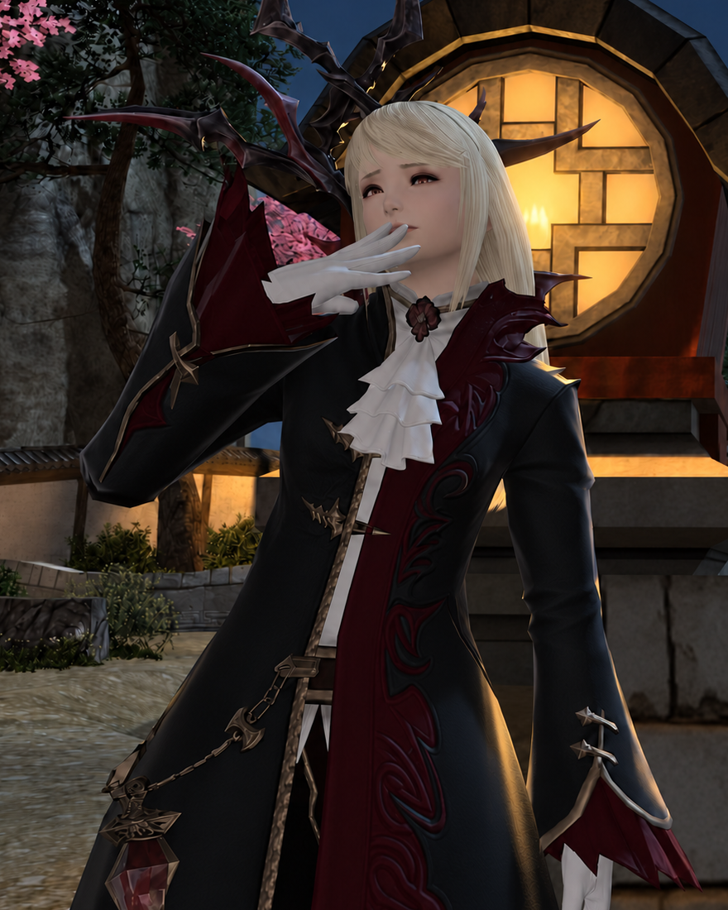
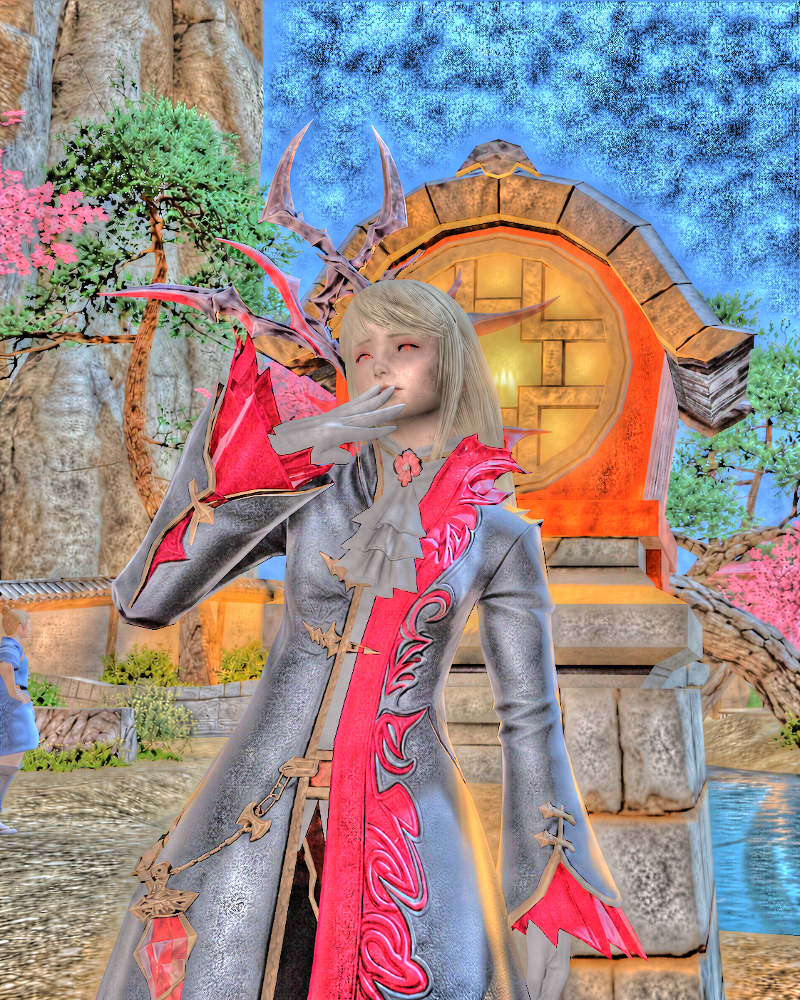
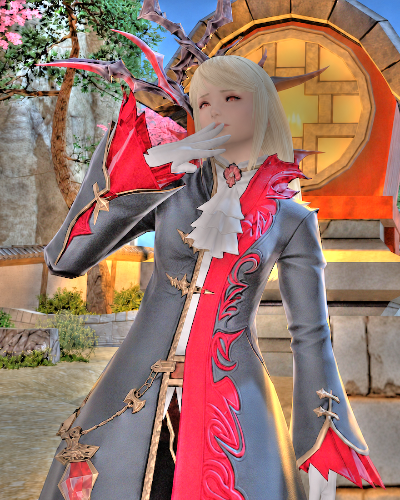
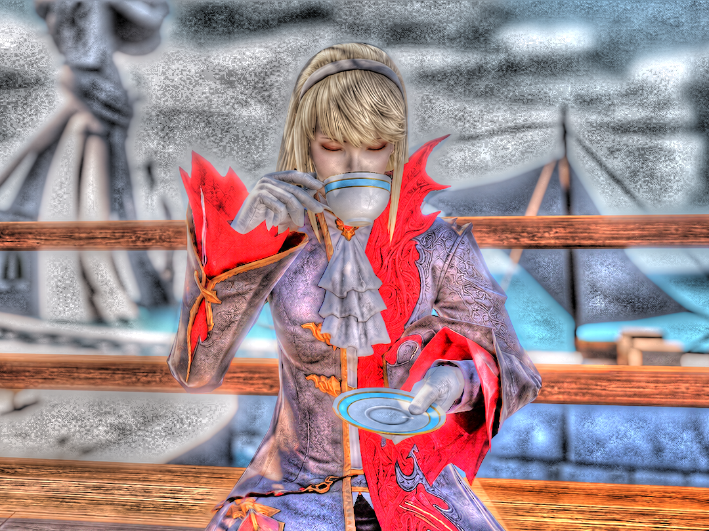

# Luma Fatal

[](https://github.com/josedelrey/luma-fatal/actions/workflows/ci.yml)

[](LICENSE)

Luma Fatal provides image and video stylization through gradient-domain
filtering. Its processing pipeline is configurable through a Python API or the
command line.

|  |  |  |
| :---: | :---: | :---: |

Left to right: original *Final Fantasy XIV* image, Fattal 1 result, and Fattal 2 result.

## Method

Both filters work with a pyramid of progressively smaller images, reducing
log-luminance gradients at different scales. They then use a Poisson solver to
rebuild brightness and combine it with color. The main difference is how they
carry those adjustments between scales: Fattal 1 builds on the attenuation from
previous scales, while Fattal 2 replaces it at each finer scale. Both are based on
[Fattal, Lischinski, and Werman (2002)](https://doi.org/10.1145/566570.566573).
See the [method notes](docs/method.md) for processing order and numerical choices.

## Install

Requires Git, Python 3.11 or later, and [uv](https://docs.astral.sh/uv/).
CI covers Linux and Windows with Python 3.11.

```bash
git clone https://github.com/josedelrey/luma-fatal.git
cd luma-fatal
uv sync --locked --python 3.11
```

See the [configuration guide](docs/configuration.md) for shell setup and presets.

Numba compiles numerical kernels on first use, so the first run takes longer.

## Process an image

Apply both filters to the bundled image:

```bash
luma-fatal apply assets/tea-by-the-water-original.png outputs/comparison \
  --config configs/fattal-1.yaml --filter both --shadow-softness 6 --output-format png
```

<a href="assets/tea-by-the-water-fattal-1.png"></a>

This writes `fattal1.png`, `fattal2.png`, and their `.meta.json` run records to
`outputs/comparison/`. Replace the input path with your own JPEG or PNG.
Explicit command-line options, including `--filter`, override the YAML settings
for that run.
For one result, pass an output filename and select `--filter fattal1` or `fattal2`.

The [configuration guide](docs/configuration.md) covers presets, tone controls,
resolution, and export. Use `luma-fatal apply --help` for CLI options.

## Process a video

Install FFmpeg and ffprobe with `zscale` and `libx264` support, then run:

```bash
luma-fatal video local_inputs/input.mp4 outputs/stylized.mp4 \
  --config configs/fattal-1.yaml --progress
```

Video inputs are prepared automatically and exported as MP4 without audio.
See the [video guide](docs/video.md) for processing options and encoding settings.

## Documentation

- [Configuration](docs/configuration.md): presets, inheritance, and effect controls.
- [Python API](docs/python-api.md): images, arrays, and decoded frame streams.
- [Method](docs/method.md): numerical behavior, color handling, and scope.
- [Experiments](docs/experiments.md): source cleanup and pre-filter noise studies.
- [Development](docs/development.md): tests, regression checks, and comparison builds.

## Tests

```bash
python -m pytest -q
python scripts/check_presets.py
```

The tests run on synthetic images included in the repository and clips generated
during testing. You'll need FFmpeg and ffprobe to run the video integration tests.

## References and license

- Raanan Fattal, Dani Lischinski, and Michael Werman (2002).
  [Gradient Domain High Dynamic Range Compression](https://doi.org/10.1145/566570.566573).
  *SIGGRAPH 2002*, pp. 249–256.
- Kaiming He, Jian Sun, and Xiaoou Tang (2013).
  [Guided Image Filtering](https://people.csail.mit.edu/kaiming/publications/pami12guidedfilter.pdf).
  *IEEE Transactions on Pattern Analysis and Machine Intelligence*, 35(6), pp. 1397–1409.
- Zeev Farbman, Raanan Fattal, Dani Lischinski, and Richard Szeliski (2008).
  [Edge-Preserving Decompositions for Multi-Scale Tone and Detail Manipulation](https://doi.org/10.1145/1360612.1360666).
  *ACM Transactions on Graphics*, 27(3), Article 67.
- Matt Pharr, Wenzel Jakob, and Greg Humphreys (2016).
  [Noise](https://www.pbr-book.org/3ed-2018/Texture/Noise).
  In *Physically Based Rendering: From Theory to Implementation*, 3rd ed., Section 10.6.
  Morgan Kaufmann.

See the [source treatment studies](docs/experiments.md) for the filtering and
noise experiments.

Project-authored code is licensed under MIT. Color conversion includes skcms
adaptations under BSD-3-Clause. Image credits and complete notices are in
[LICENSE](LICENSE).
